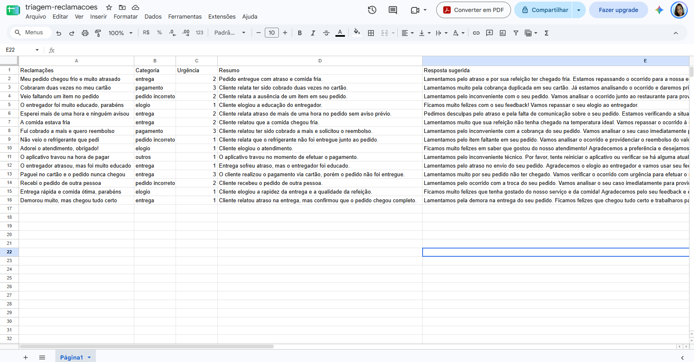
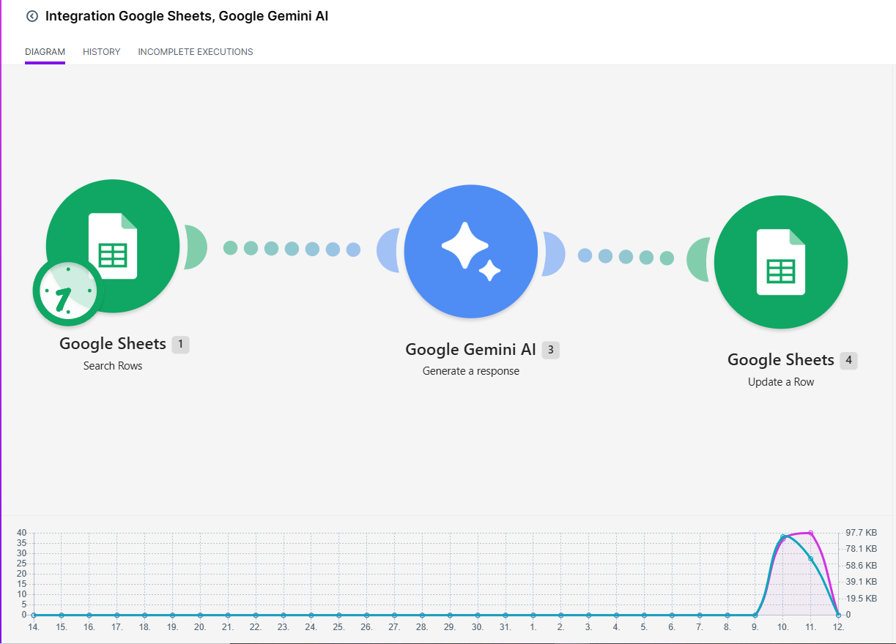

# Triagem de reclamações com IA

**Em uma frase:** uma automação que lê reclamações de clientes de um app de delivery fictício, classifica cada uma, define a urgência, escreve um resumo e sugere uma resposta educada, gravando tudo numa planilha.

Projeto de portfólio de Jaqueline, estudante de Análise e Desenvolvimento de Sistemas. Todos os dados são fictícios.

## O problema
Equipes de atendimento recebem muitas reclamações e precisam separar, priorizar e responder cada uma. Fazer isso à mão é lento e varia de pessoa para pessoa.

## Exemplo
| Entrada | Saída |
| --- | --- |
| "Meu pedido chegou frio e muito atrasado" | **Categoria:** entrega. **Urgência:** 2. **Resumo:** pedido entregue com atraso e comida fria. **Resposta sugerida:** "Lamentamos pelo atraso e por sua refeição ter chegado fria. Estamos repassando o ocorrido para a nossa equipe melhorar as próximas entregas." |

## Como funciona
1. As reclamações ficam numa planilha do Google Sheets.
2. O Make (ferramenta de automação) lê cada linha e a envia ao Gemini, junto com as instruções de [prompt_v2.txt](prompt_v2.txt).
3. O Gemini responde em JSON, com categoria, urgência, resumo e resposta sugerida.
4. O Make grava o resultado na mesma linha da planilha.

## Como montei no Make

O Make (make.com) é uma ferramenta que liga aplicativos sem precisar programar. Eu montei um "cenário": uma fila de 3 módulos, em que a saída de um vira a entrada do próximo. Usei a conta gratuita.

### Passo 1: preparar a planilha
No Google Sheets, criei a aba "Página1" com as colunas **Reclamações**, **Categoria**, **Urgência**, **Resumo** e **Resposta sugerida**. Escrevi 15 reclamações fictícias na coluna A e deixei as outras colunas vazias. Elas são preenchidas pela automação.

### Passo 2: conectar o Make ao Google
No Make, criei um cenário novo e conectei minha conta Google, marcando todas as permissões pedidas (sem isso o Make não conseguiu ler a planilha).

### Passo 3: os 3 módulos

| Módulo | O que faz | O que entra | O que sai |
|---|---|---|---|
| **1. Google Sheets, Search Rows** | Procura na planilha as linhas que ainda não foram classificadas (Categoria vazia). Limite de 4 linhas por execução. | A planilha | Uma reclamação por vez, com o número da linha |
| **2. Google Gemini AI, Generate a response** | Manda a reclamação para a IA. Em "System Instructions" vai o texto do `prompt_v2.txt`. Em "Messages" vai `Reclamação: ` seguido do texto da coluna A. A resposta é configurada como "JSON Output". | O texto da reclamação | Um JSON com categoria, urgência, resumo e resposta sugerida |
| **3. Google Sheets, Update a Row** | Escreve cada campo do JSON na coluna certa, na mesma linha da reclamação. | O JSON e o número da linha | A linha preenchida na planilha |

### Passo 4: como o fluxo roda
Quando clico em **Run once**, o módulo 1 devolve até 4 linhas. Para **cada linha**, o Make roda os módulos 2 e 3 em sequência. No fim, a planilha mostra as linhas preenchidas. Depois espero 1 minuto e rodo de novo para as próximas, porque o plano gratuito do Gemini aceita só 5 pedidos por minuto e 20 por dia. Foram 3 execuções para as 15 reclamações.

### Passo 5: conferir
Comparei cada linha com o meu gabarito. Quando a IA errou (a frase sobre horário de funcionamento), melhorei o prompt (v1 para v2) e rodei de novo.

## Arquivos
- `triagem.py`: versão inicial em Python, que classifica por palavras-chave. Serve como ponto de comparação.
- `prompt_v1.txt` e `prompt_v2.txt`: as instruções dadas à IA, antes e depois da melhoria.
- `testes-chatgpt.md` e `testes-gemini.md`: as 25 frases testadas em cada IA, com as respostas.
- `resultados.md`: os números dos testes e a comparação de tempo.
- `cenario-make.png` e `planilha-preenchida.png`: o fluxo no Make e a planilha com o resultado.

## Resultados
Testei as mesmas frases com um script simples e com a IA. As respostas de cada frase estão em [testes-chatgpt.md](testes-chatgpt.md) e [testes-gemini.md](testes-gemini.md).

| Método | Acertos (categoria) |
| --- | --- |
| Script com palavras-chave (15 frases) | 10 de 15 (66,7%) |
| ChatGPT, 15 frases iniciais | 15 de 15 |
| Gemini, 15 frases iniciais | 15 de 15 |
| ChatGPT, 10 frases difíceis | 10 de 10 |
| Gemini, 10 frases difíceis (prompt v1) | 9 de 10 |
| Automação no Make (Gemini, prompt v2), 15 frases | 15 de 15 |

Contei como acerto só a categoria. Urgência e resposta sugerida não entraram na conta, porque não defini um gabarito para elas. O gabarito foi definido por mim, e algumas frases são ambíguas.

### Três exemplos comparados
| Tipo | Frase | Esperado | Script | IA |
| --- | --- | --- | --- | --- |
| Fácil | Cobraram duas vezes no meu cartão | pagamento | pagamento | pagamento |
| Ambígua | Paguei no cartão e o pedido nunca chegou | entrega | pagamento (errou) | entrega |
| Difícil | Parabéns, só 3 horas de espera, muito rápido | entrega | elogio (errou) | entrega |

O script erra quando a frase tem uma palavra-chave que engana ("cartão", "parabéns"). A IA entende o contexto, inclusive o sarcasmo do terceiro exemplo.

## Tempo
Comparei o tempo de tratar as mesmas 15 reclamações da planilha.

- **À mão:** cerca de 2 minutos e 30 segundos por reclamação (cronometrado, só categoria e urgência), o que dá cerca de 37 minutos e 30 segundos para as 15.
- **Com a automação:** 101 segundos para as 15, em 3 execuções (cerca de 7 segundos por reclamação), já incluindo também o resumo e a resposta sugerida.
- Isso dá cerca de 22 vezes mais rápido no processamento. A comparação favorece o trabalho à mão, porque a automação fez mais (resumo e resposta) no tempo medido.
- O tempo de montar o fluxo no Make (vários dias de testes e correções) não está incluído.
- Com poucas reclamações, fazer à mão ainda compensa. O ganho aparece em grande volume.

## Problemas que encontrei e como resolvi
| Problema | O que aconteceu | Como resolvi |
|---|---|---|
| Erro 403 na planilha | O Make não tinha permissão para ler a planilha | Refiz a conexão marcando todas as permissões do Google |
| Erro 404 no Gemini | O modelo que eu usava deixou de existir | Troquei por um modelo atual (gemini-3.6-flash) |
| Prompt não chegava ao Gemini | O módulo simples mandava só a frase da reclamação | Passei a usar "Generate a response", com System Instructions |
| JSON inteiro numa célula só | A resposta vinha em texto corrido | Configurei "Response Format: JSON Output" |
| Dados nas colunas erradas | Eu tinha colocado todos os campos em todas as colunas | Mapeei um campo por coluna e o número da linha no Row number |
| Erro 429 (limite) | O plano gratuito permite 5 pedidos por minuto e 20 por dia | Rodei em lotes de 3 a 4 linhas, filtrando as já preenchidas |
| Erro 503 | O Gemini estava sobrecarregado | Esperei e rodei de novo |
| Frase que não era reclamação | O Gemini fez uma pergunta e respondeu fora do formato JSON | Criei o prompt v2 com a regra "outros" e a proibição de perguntas |

## O que aprendi
- Medir antes de automatizar: comparar com um script simples mostrou o que a IA realmente melhora.
- Conferir o que chega ao modelo, e não só o que eu escrevi.
- Respostas de IA podem mudar de formato, então o fluxo precisa tratar isso.
- Planos gratuitos têm limites que afetam o plano de testes.

## Uso de IA no desenvolvimento
Usei ChatGPT e Gemini como apoio para escrever e revisar o prompt e o código. Eu defini as categorias e o gabarito, rodei os testes, medi os acertos e decidi os ajustes.

## O que ainda não funciona
- Poucos dados de teste (15 a 25 frases), fictícios, com gabarito definido por mim.
- O limite do plano gratuito obriga a processar em lotes.
- Não trata reclamações em outros idiomas nem textos muito longos.
- A resposta sugerida precisa de revisão humana antes de ser enviada a um cliente.

## Próximos passos
- Limitar as categorias com um esquema de resposta (Response Schema).
- Processar só as linhas novas e com intervalo automático entre as chamadas.
- Testar com mais frases e com um segundo avaliador para o gabarito.

